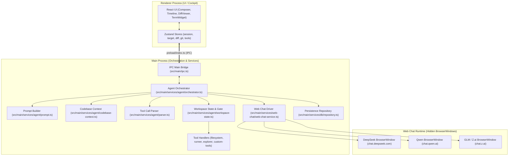
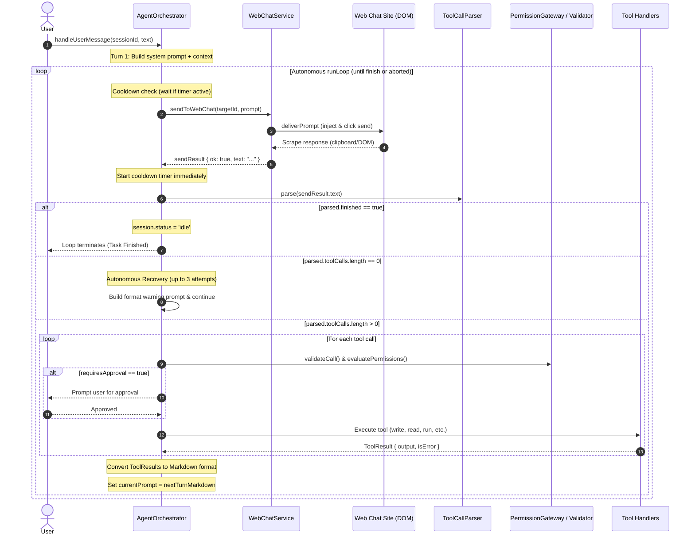
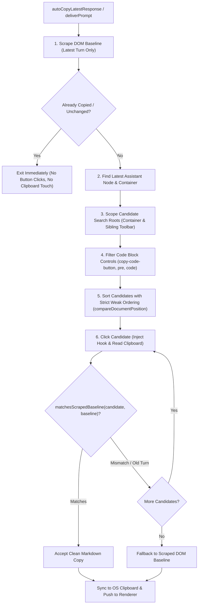

# ABPPAgent System Documentation

Comprehensive technical design and architecture guide for **ABPPAgent** (AnythingButProPlan Agent) — an autonomous software engineering agent harness powered by real, web-based LLM chat platforms (DeepSeek, Qwen, GLM/Z.ai) with an interactive OpenCode-style UI.

---

## Table of Contents
1. [High-Level Architecture](#1-high-level-architecture)
2. [Prompt Architecture & Templating](#2-prompt-architecture--templating)
3. [The Autonomous Execution Loop](#3-the-autonomous-execution-loop)
4. [Delays, Pacing, and Cooldown Mechanisms](#4-delays-pacing-and-cooldown-mechanisms)
5. [Completion & Intent Detection](#5-completion--intent-detection)
6. [Web Chat Driver & Extraction Engine](#6-web-chat-driver--extraction-engine)
7. [Error Recovery, Resilience & Guardrails](#7-error-recovery-resilience--guardrails)
8. [Session Persistence & IPC Layer](#8-session-persistence--ipc-layer)

---

## 1. High-Level Architecture

ABPPAgent is built on **Electron**, **Vite**, and **React**, separating responsibilities into three major tiers:



### Core Responsibilities
- **Renderer Process**: Provides the developer cockpit. Renders the conversation timeline, streaming tool execution, diff viewers for proposed file changes, approval prompts, and configuration modals.
- **Main Process**: Drives the autonomous lifecycle. Constructs prompts, handles multi-turn loops, enforces security boundaries, manages local child processes, tracks file history, and persists session states atomically.
- **Web Chat Windows**: Dedicated background `BrowserWindow` instances that hold authenticated web chat sessions. Injects prompts directly into page DOM elements, monitors generation, and copies/scrapes assistant replies without opening third-party API keys.

---

## 2. Prompt Architecture & Templating

The agent's prompts are designed to steer standard conversational models into structured, autonomous tool execution agents while maintaining strict context window efficiency.

### 2.1 Base System Prompt Template
Defined in [`src/main/services/agent/base-prompt.ts`](file:///data/arts/ABPPAgent/src/main/services/agent/base-prompt.ts), the base prompt defines:
1. **Identity & Role**: Autonomous software engineering agent operating directly within the user's workspace.
2. **Workspace Directory**: Substituted via `{{workspacePath}}`.
3. **Project Context**: Dynamic codebase map and suggested relevant files substituted via `{{projectContext}}`.
4. **Available Tools**: Dynamic list of active tool schemas substituted via `{{availableTools}}`.
5. **Strict JSON Turn Format**: The requirement that **every turn** must return a JSON object (or JSON array for batched calls) with `thought`, `tool_call_name`, and `parameter`.
6. **Context-First Policy**: Prohibits re-reading files whose content is already in context (marked `completeness=FULL` or having identical SHA256 hashes).

### 2.2 Dynamic Tool Schemas
Available tools are generated on-the-fly in [`src/main/services/agent/prompt.ts`](file:///data/arts/ABPPAgent/src/main/services/agent/prompt.ts) based on `CustomToolsConfig` toggles:

| Tool Name | Parameters | Purpose |
| :--- | :--- | :--- |
| `run_command` | `CommandLine` (str), `Cwd`? (str) | Executes terminal commands in the workspace shell with real-time streaming chunks. |
| `read_file` | `AbsolutePath` (str), `StartLine`? (int), `EndLine`? (int) | Reads lines 1-indexed. Used for targeted inspection. |
| `read_file_full` | `AbsolutePath` (str) | Reads entire file into context without line numbers (max 2MB). |
| `copy_file_to_chat` | `AbsolutePath` (str) | Loads entire file into context and system clipboard. |
| `write_file` | `TargetFile` (str), `CodeContent` (str), `Overwrite`? (bool) | Creates or overwrites files with truncation safety checks. |
| `replace_file_content` | `TargetFile` (str), `TargetContent` (str), `ReplacementContent` (str) | Surgically replaces exact contiguous code blocks. |
| `list_directory` | `DirectoryPath`? (str), `Recursive`? (bool), `Depth`? (int) | Lists directory tree respecting `.gitignore` rules. |
| `ask_user` | `Question` (str), `Options`? (str[]) | Pauses the loop to ask the user a clarifying question or render option buttons. |
| `gitnexus_query` | `Query` (str) | Semantic symbol search across the codebase graph. |
| `gitnexus_context` | `Target` (str) | Symbol relationships and dependency context. |
| `grep_search` | `Query` (str), `Path`? (str) | Fast recursive regex search (`grep -rnE`). |
| `finish` | `summary`? (str) | Signals task completion. Breaks the autonomous loop. |

### 2.3 Strict Format Enforcement Rule
At the end of the initial system prompt and appended to **every outgoing prompt** via `appendToolJsonFormatRule()`, the agent enforces:
```markdown
### Strict Response Requirement (MANDATORY)
You MUST respond with a valid JSON tool call object (or a JSON array if batching multiple tools).
Do NOT include conversational narration, explanations, or code outside the tool JSON format.
Every response MUST follow this exact format:
```json
{
  "thought": "Brief step-by-step reasoning explaining what you are doing",
  "tool_call_name": "<name of tool from AVAILABLE TOOLS>",
  "parameter": { ... }
}
```
If your task is complete and verified, you MUST invoke the "finish" tool:
```json
{
  "thought": "The requested task is complete and verified",
  "tool_call_name": "finish",
  "parameter": { "summary": "Concise summary of what was done" }
}
```
```

### 2.4 Codebase Context Generation
Before the first turn, [`generateCodebaseContext()`](file:///data/arts/ABPPAgent/src/main/services/agent/codebase-context.ts) constructs a high-signal snapshot of relevant project files using a multi-stage pipeline:
1. **Tokenization & Synonym Expansion**: Extracts keywords from the user prompt and expands them using a domain synonym index (`login` $\to$ `auth`, `token`, `session`).
2. **BM25 Search**: Indexes all candidate source code files in the workspace (excluding binaries, lockfiles, and media) and ranks them using BM25 relevance scoring.
3. **GitNexus Graph & Symbol Hits**: Queries the local `gitnexus` index for symbol matches.
4. **Git Co-Change History**: Inspects recent git commit history to detect files that frequently change together with top candidate seed files.
5. **Jev Re-ranking (Optional)**: If configured with a TypeSafe API key, sends file skeletons to the Jev precision scoring endpoint.
6. **Budgeted Injection**: Fits the top ranked files into a token budget, including full file content for top seeds and compact signature skeletons for peripheral files.

---

## 3. The Autonomous Execution Loop

The core orchestration engine lives in [`AgentOrchestrator`](file:///data/arts/ABPPAgent/src/main/services/agent/orchestrator.ts).

### 3.1 Loop Lifecycle Sequence



### 3.2 Turn 1 vs Subsequent Turns
- **Turn 1 (Initial User Prompt)**:
  ```text
  [System Prompt: Base Template + Workspace Path + Project Context + Available Tools]

  # User Goal
  <User Instruction>

  ### Strict Response Requirement (MANDATORY)
  ...
  ```
- **Turn $2..N$ (Follow-up Tool Result Turns)**:
  Instead of resending the entire system prompt, subsequent turns send only the formatted tool execution results:
  ```markdown
  ### Tool Result: `read_file`
  1: import React from 'react'
  2: export function App() { ... }
  [sha256=a1b2c3d4e5f6 bytes=1240]

  ### Strict Response Requirement (MANDATORY)
  ...
  ```
  The chat site preserves the conversation history in its own browser session, saving tokens and speeding up generation.

---

## 4. Delays, Pacing, and Cooldown Mechanisms

To prevent rate-limiting, simulate realistic human pacing, and avoid race conditions during web interaction, ABPPAgent implements a multi-tier delay architecture:

### 4.1 Cooldown Timer Formula
The cooldown timer runs between turns and is governed by [`computeCooldownDuration()`](file:///data/arts/ABPPAgent/src/main/services/agent/orchestrator.ts#L33-L42):

$$\text{CooldownDuration} = \text{cooldownTimerMs} + \text{random}(\text{minRandomMs}, \text{maxRandomMs})$$

- **Default Base Timer (`cooldownTimerMs`)**: 3,000 ms.
- **Random Jitter (`cooldownRandomDelayMinMs` / `maxMs`)**: Optional Gaussian-like randomized jitter to prevent detection patterns.
- **Immediate Anchoring**:
  ```ts
  // orchestrator.ts
  cooldownExpiresAt = Date.now() + cooldownDuration
  ```
  The cooldown timer is anchored **immediately upon receipt of the scraped LLM response**. While tools are executing locally (which often takes 1–5 seconds), the cooldown clock is already ticking. If tools take longer than the cooldown, the next prompt sends immediately without wasted waiting.

### 4.2 Interaction & Typing Delays
In [`web-chat-service.ts`](file:///data/arts/ABPPAgent/src/main/services/web-chat/web-chat-service.ts#L1837-L1840):
- **Send Delay (`sendDelayMs`)**: Default 1,000 ms.
- **Random Jitter (`randomMinMs` - `randomMaxMs`)**: 50 ms – 150 ms.
- Applied inside `buildScript` between focusing the input textarea, injecting the text, and firing the submission sequence:
  ```javascript
  await sleep(sendDelayMs + jitter);
  ```

### 4.3 Sequential Tool Execution Delay
In [`orchestrator.ts`](file:///data/arts/ABPPAgent/src/main/services/agent/orchestrator.ts#L349-L353):
- When an LLM batches multiple tool calls in a single turn (e.g. `list_directory` followed by `grep_search`), an inter-tool pause (`toolExecutionDelayMs`, default 150 ms) is enforced between tool executions to allow file I/O to flush and ensure terminal stream chunks are ordered properly in the renderer UI.

### 4.4 Web Chat Background Status Polling Interval
In [`web-chat-service.ts`](file:///data/arts/ABPPAgent/src/main/services/web-chat/web-chat-service.ts#L269):
- **Constant**: `STATUS_POLL_INTERVAL_MS = 1000` (1 second).
- The background window supervisor runs `runPollerCycle()` on a fixed 1-second recurring timer across all open provider windows.
- Unlike previous versions that backed off to 3,000 ms during idle states, polling is fixed at **every 1 second** (`STATUS_POLL_INTERVAL_MS`) to ensure instant detection of state changes (idle $\to$ working, working $\to$ paused, or generation completion).

---

## 5. Completion & Intent Detection

Because web chat models are conversational by nature, the agent uses specialized detectors to distinguish between real tool execution, conversational intent, helplessness, and completion.

### 5.1 Finish Detection
Task completion occurs when the model outputs a tool call with name `"finish"`:
```json
{
  "thought": "All tests pass and the component is updated.",
  "tool_call_name": "finish",
  "parameter": {
    "summary": "Updated App.tsx and verified with npm test."
  }
}
```
When `ToolCallParser.parse()` detects `name === 'finish'`, it sets `parsed.finished = true`. The orchestrator records the finish item, marks the session `'idle'`, and breaks the loop.

### 5.2 Intent & Vagueness Detection (`AgentIntentDetector`)
If an LLM returns a conversational reply without any tool calls, [`AgentIntentDetector`](file:///data/arts/ABPPAgent/src/main/services/agent/orchestrator.ts#L65-L116) evaluates whether the response is an unfulfilled declaration of intent:
1. **Completion Bypass**: Text containing completion phrases (`task is completed`, `successfully updated`, `here is the summary`) is recognized as finished even if the model forgot the explicit `finish` tool syntax.
2. **Colon Endings**: Messages ending with a colon (e.g., `"Now let me read PersonModal to inspect the props:"`) indicate the model intended to act but hallucinated that it was in a conversational back-and-forth.
3. **Intent Patterns**: Verbs like `let me read`, `i will check`, `i'll search`, `going to update`.
4. **Short Conversational Replies**: Replies under 250 characters saying `"Okay, on it!"` or `"Understood, I will look into this."` are flagged as vague.

### 5.3 Helplessness & Doubt Detection (`AgentDoubtDetector`)
[`AgentDoubtDetector`](file:///data/arts/ABPPAgent/src/main/services/agent/orchestrator.ts#L44-L63) detects when an LLM falsely believes it is trapped in a browser without local capabilities:
- Patterns caught:
  - `"tools are no longer available"`
  - `"only have web search tools"`
  - `"cannot read back the file"`
  - `"please run npm test in your terminal"`
  - `"could you run git status for me"`

### 5.4 3-Strike Autonomous Recovery Loop
When no valid tool call is found and the task is not finished:
1. **Attempts 1–3**:
   - The orchestrator issues a high-priority warning prompt via `buildToolFormatWarningPrompt(customTools, issue)`.
   - The prompt provides the exact diagnostic (`"Agent expressed doubt about tool availability. Notice: all workspace tools listed below are 100% active and autonomous."`).
   - The complete tool schema is re-attached to prompt the model back into JSON mode.
2. **Attempt 4+**:
   - If the model continues to fail after 3 consecutive reprompts, the orchestrator sets `session.status = 'paused'`, records a warning timeline event, and pauses execution so the user can intervene.

---

## 6. Web Chat Driver & Extraction Engine

[`web-chat-service.ts`](file:///data/arts/ABPPAgent/src/main/services/web-chat/web-chat-service.ts) is the core browser automation engine.

### 6.1 Provider Profiles
Provider-specific selectors and DOM scripts are defined in [`src/main/services/web-chat/profiles/`](file:///data/arts/ABPPAgent/src/main/services/web-chat/profiles/):

| Provider | Target URL | Composer Type | Stop / Busy Indicators | Response Scope |
| :--- | :--- | :--- | :--- | :--- |
| **DeepSeek** | `https://chat.deepseek.com/` | `textarea#chat-input` | `svg rect` animation, stop button, "继续生成" | `.ds-markdown`, `.markdown` |
| **Qwen** | `https://chat.qwen.ai/` | `textarea.message-input-textarea` | `button.stop-button`, `button[aria-label*="停止" i]`, `.chat-response-message .ant-spin`, `.qwen-chat-thinking-status-card-loading` | `.chat-response-message .custom-qwen-markdown`, `.chat-response-message` |
| **GLM (Z.ai)** | `https://chat.z.ai/` | `textarea#chat-input` | `#send-message-button`, `button[aria-label*="停止" i]`, `.chat-assistant .animate-spin`, `.thinking-chain-container` | `[data-message-role="assistant"] .markdown-prose`, `.chat-assistant` |

#### Scoped Busy Detection
To prevent false-positive busy detections:
- **Assistant Container Scoping**: Busy indicators (such as `.ant-spin`, `.animate-spin`, `svg[class*="spin" i]`) are evaluated **strictly within assistant message cards or thinking status wrappers** (`.chat-response-message`, `.chat-assistant`, `[data-message-role="assistant"]`).
- **Sidebar & Page Spinner Exclusion**: Spinners inside global navigation (`nav`, `aside`, `header`, `[class*="sidebar" i]`, `[class*="history" i]`, user profile menus, or notification popups) are explicitly ignored. This ensures that session list background fetching never falsely marks an idle chat as actively generating.
- **Excluded Code Copy Selectors**: Code block controls (`button.copy-code-button`) are strictly excluded from response copy candidate pools, preventing code snippets from overriding full conversation replies.

### 6.2 Prompt Injection Mechanics
Because browser windows are hidden (`show: false`), traditional `document.execCommand` and direct `.value` assignment often fail to update internal React/Vue state machines:
- **Textarea Inputs (DeepSeek, Qwen, GLM)**:
  Uses the native prototype descriptor setter:
  ```javascript
  const proto = HTMLTextAreaElement.prototype;
  const desc = Object.getOwnPropertyDescriptor(proto, 'value');
  desc.set.call(input, promptValue);
  input.dispatchEvent(new Event('input', { bubbles: true }));
  input.dispatchEvent(new Event('change', { bubbles: true }));
  ```
- **Rich-Text & ContentEditable Editors**:
  Dispatches synthetic `ClipboardEvent('paste')` carrying a `DataTransfer` object. Lexical and ProseMirror handle paste events natively in memory, updating their internal `EditorState` without requiring OS window focus.

### 6.3 Synthetic Submission Sequences
Modern web apps bind event listeners to PointerEvents rather than plain `.click()`. The submission dispatcher fires a complete 5-stage event sequence:
$$\text{pointerdown} \longrightarrow \text{mousedown} \longrightarrow \text{pointerup} \longrightarrow \text{mouseup} \longrightarrow \text{click}$$
If the send button remains disabled, the script falls back to dispatching an `isTrusted`-simulated `Enter` KeyboardEvent on the input textarea.

### 6.4 Streaming & Generation Monitoring
Generation and window states are monitored through a continuous 1-second polling architecture:

1. **1-Second Poller Loop (`runPollerCycle`)**:
   - Executes `pollOpenWindowsStatus()` every `1000` ms (`STATUS_POLL_INTERVAL_MS`) across all open `BrowserWindow` instances.
   - Evaluates provider inspection scripts in each active window context without stealing window focus.
   - Emits state updates (`idle`, `working`, `paused`) via the IPC bridge `webchat:status-update` to the UI.
2. **In-Page Status Inspection (`buildStatusInspectionScript`)**:
   - **Paused State**: Detects provider pause alerts or resume prompts (e.g. DeepSeek's "继续生成" / Continue Generating buttons).
   - **Stop Selectors**: Presence and visibility of stop/cancel buttons in the DOM (`profile.stopSelectors`, including Chinese stop labels `停止`).
   - **Busy Classes / Spinners**: Provider-scoped thinking status cards and spinners.
   - **Damped Text Growth & Node Tracking**:
     - `window.__AnythingButProPlanLastObservedNode` tracks the active DOM node of the newest assistant message.
     - When a new turn node appears (`last !== __AnythingButProPlanLastObservedNode`), status immediately flips to `'working'`.
     - When inspecting the same turn node, text is only considered actively streaming if its length expands significantly (`text.length > __AnythingButProPlanLastObservedText.length + 5`).
     - **Infinite Loop Prevention**: Button label changes ("Copy" $\to$ "Copied" / "已复制", $+2$ chars) or temporary UI toasts modify the message text by only a few characters. Damping prevents these UI feedback changes from bouncing status back to `'working'`, which previously triggered endless copy loops.
3. **Debounced Idle Confirmation (`IDLE_CONFIRMATION_THRESHOLD = 2`)**:
   - To prevent premature extraction during transient network pauses or between reasoning and answer phases, the system requires **2 consecutive 'idle' polls** (spanning 2 seconds) before transitioning from `'working'` to `'idle'`.
   - Once idle is confirmed, `autoCopyLatestResponse(targetId)` is triggered to extract the response into the UI.
4. **Duplicate Suppression in `autoCopyLatestResponse`**:
   - Before executing button clicks or modifying the OS clipboard, `autoCopyLatestResponse` scrapes the latest assistant message DOM first (`scrapeLatestAssistantResponse`).
   - If the scraped text is identical to `lastScrapedResponses.get(targetId)` or matches `lastCopiedResponses.get(targetId)` via `matchesScrapedBaseline()`, extraction returns immediately. No copy buttons are clicked, no OS clipboard writes occur, and no UI toasts are triggered.

### 6.5 Extraction: Scoped Candidate Discovery & Baseline Validation
Scraping raw DOM with `innerText` destroys Markdown formatting, collapses tables, and drops code block backticks. The engine implements a **clipboard-first extraction** pipeline with strict scoping:



1. **Latest-Turn Scoped Candidate Collection (`buildCollectCopyCandidatesScript`)**:
   - Locates the latest assistant message node via `queryTopLevelTurns(respSels)`.
   - Derives `latestTurnContainer = latestNode.closest('article, [data-message-role="assistant"], .chat-response-message, .chat-assistant, ...')`.
   - **Search Roots**: Restricts search strictly to `latestTurnContainer`, its immediate `nextElementSibling`, and adjacent message toolbars.
   - **Preceding Button Rejection**: In document-wide fallback searches, any button that precedes `latestNode` in document position (`b.compareDocumentPosition(latestNode) & Node.DOCUMENT_POSITION_FOLLOWING`) is rejected, ensuring buttons from earlier turns (turns $1..N-1$) are never collected.
   - **Code Control Rejection (`isCodeBlockControl`)**: Rejects any button inside `pre`, `code`, `[class*="code-block" i]`, or matching `copy-code-button` / `code-copy`.
2. **Stable Document-Order Sorting**:
   - Solves V8 Timsort contract violations by implementing a strict weak ordering comparator:
     ```javascript
     outerPool.sort((a, b) => {
       if (a === b) return 0;
       const pos = a.compareDocumentPosition(b);
       if (pos & Node.DOCUMENT_POSITION_FOLLOWING) return -1;
       if (pos & Node.DOCUMENT_POSITION_PRECEDING) return 1;
       return 0;
     });
     ```
   - Guarantees buttons are sorted strictly in top-to-bottom document order without random shuffling.
3. **Hook Ingestion & Sentinel Write**:
   - Injects in-page hooks capturing `navigator.clipboard.writeText` and `DataTransfer.prototype.setData`.
   - Writes a unique timestamped sentinel (`__AnythingButProPlan_<timestamp>__`) to the OS clipboard before clicking candidate buttons.
4. **Baseline Content Validation (`matchesScrapedBaseline`)**:
   - Normalizes candidate text and baseline text (stripping markdown characters, punctuation, and whitespace).
   - Compares 30-character prefix and suffix anchors from the scraped baseline against the candidate text.
   - If a candidate's text belongs to an older turn, a foreign message, or an isolated code snippet, it is rejected.
   - If all copy attempts fail or produce mismatched content, the system falls back safely to the scraped DOM baseline and restores the previous user clipboard.

### 6.6 DOM-to-Markdown Fallback Serializer
If clipboard copying fails, `buildCleanAssistantTextFunction()` walks the rendered DOM:
- **Pure Latest-Turn Extraction**: `buildScrapeLatestAssistantResponseScript` inspects **only the latest assistant turn node** (`nodes[nodes.length - 1]`). It avoids backwards loops into turns $N-1$, ensuring reasoning or empty state containers never cause the agent to scrape older answers.
- **Stripping Clutter**: Removes toolbar buttons, download labels, and provider-specific reasoning elements (`.ds-thought`, `.qwen-chat-thinking-status-card-content`, `.thinking-chain-container`).
- **AST Walking**: Preserves `#` headings, `-` list items, `|` table cells, and code fences (```` ``` ````).

### 6.7 Multi-Pass True Bottom Auto-Scrolling
To ensure the user sees the latest response when opening the chat window, `scrollChatWindowToBottom()`:
1. Identifies scrollable containers via `window.getComputedStyle(el).overflowY`.
2. Sets `scrollTop = scrollHeight` with `scrollBehavior = 'auto'`.
3. Scrolls the composer footer into view (`scrollIntoView({ block: 'end' })`).
4. Executes multi-pass settling scrolls (+0ms, +250ms, +500ms) to account for post-render Markdown height expansions.

---

## 7. Error Recovery, Resilience & Guardrails

### 7.1 Catastrophic File Truncation Guardrail
In [`src/main/services/tools/filesystem.ts`](file:///data/arts/ABPPAgent/src/main/services/tools/filesystem.ts#L130-L140):
- **Problem**: When an LLM outputs unescaped double quotes inside a JSON `write_file` call, JSON parsers may truncate the code string, resulting in overwriting a 1,000-line file with a 15-character snippet.
- **Guardrail**: If the existing file is $>400$ bytes and incoming `CodeContent` is $<100$ bytes and $<15\%$ of existing file size, the write is **rejected outright**:
  ```text
  Safety Guardrail: Overwrite rejected! Target file 'Component.tsx' is 1250 bytes, but incoming CodeContent is only 22 bytes. Existing file was NOT modified.
  ```

### 7.2 Redundant Re-read Throttling (`checkReread`)
In [`src/main/services/agent/workspace-state.ts`](file:///data/arts/ABPPAgent/src/main/services/agent/workspace-state.ts#L80-L91):
- Tracks SHA256 hashes of all files read during a session.
- **1st Redundant Read**: Allowed with an appended warning: `[warning: this file was unchanged since you last read it. Do not reread files you already have]`.
- **2nd+ Redundant Read**: Blocked with an error: `Error: file is unchanged since you last read it; its full content is already in your context. Edit the file directly.`
- **Invalidation**: Writing to a file (`write_file`, `replace_file_content`) immediately clears the cached hash via `forget(sessionId, filePath)`.

### 7.3 Repetition Detection Guardrail
In [`orchestrator.ts`](file:///data/arts/ABPPAgent/src/main/services/agent/orchestrator.ts#L378-L398):
- Maintains a circular buffer of the last 20 executed tool calls (`name`, `argsHash`, `output`, `isError`).
- If an agent repeats the exact same tool call with identical arguments that previously failed or returned `(No matches found)` / `0 results`, execution is intercepted and blocked:
  ```text
  Error: Repetition detected! You executed this exact same tool call 'grep_search' with identical parameters in a previous turn, which returned: "(No matches found)". Do NOT repeat identical commands. Change your search query or check a different directory.
  ```

### 7.4 Cold Startup Session Sanitization
In [`src/main/services/db/repository.ts`](file:///data/arts/ABPPAgent/src/main/services/db/repository.ts#L60-L75):
- When the app is closed, crashes, or receives `SIGINT` while an agent is running, `sessions.json` previously retained `"status": "running"`. On the next app launch, the UI would render the "Abort" button and disable the input box.
- `SessionRepository.sanitizeSessionsOnStartup()` runs inside `app.whenReady()`, scanning all persisted sessions and resetting any lingering `'running'` sessions to `'idle'`.

### 7.5 Process Termination & Window Teardown
In [`src/main/index.ts`](file:///data/arts/ABPPAgent/src/main/index.ts):
- Listens to `mainWindow.on('closed')`, `app.on('before-quit')`, and process signals (`SIGINT`, `SIGTERM`).
- Calls `AgentOrchestrator.abortAll()`, which cancels all active `AbortController` instances, unblocks pending user approvals, and immediately destroys all hidden web chat `BrowserWindow` instances to eliminate orphaned background processes.

### 7.6 Web Chat Infinite Copying & Cross-Turn Pollution Guardrails
In [`src/main/services/web-chat/web-chat-service.ts`](file:///data/arts/ABPPAgent/src/main/services/web-chat/web-chat-service.ts):
- **Feedback Loop Interception**: Prevents UI-state mutation loops where copying a response modifies the DOM button label ("Copy" $\to$ "Copied"), which previously caused the 1-second supervisor to re-flag the window as `'working'`. Damped character thresholding (`> +5` chars) and active node tracking ensure only genuine streaming token growth keeps the supervisor in the `'working'` state.
- **Pre-Execution Duplicate Check**: `autoCopyLatestResponse` checks whether the latest response has already been processed against `lastScrapedResponses` and `lastCopiedResponses` before firing synthetic click events or touching the OS clipboard.
- **Cross-Turn Mismatch Rejection**: Any candidate text collected from earlier turns or isolated code snippets is compared against the scraped baseline via `matchesScrapedBaseline()`. If the candidate text does not share the baseline's normalized prefix/suffix anchors, it is rejected and execution safely defaults to the scraped turn.
- **Preceding Turn Rejection**: All DOM buttons preceding the newest assistant turn in document position are filtered out, ensuring buttons from turns $1..N-1$ can never be clicked during extraction.

---

## 8. Session Persistence & IPC Layer

### 8.1 Atomic Storage Architecture
All agent data is persisted in JSON files inside `app.getPath('userData')/agent_data` (or `.agent-data` in development):
- `sessions.json`: List of active and historical agent sessions.
- `session-defaults.json`: User-configured delay presets and tool enablement defaults.
- `timeline_<sessionId>.json`: Chronological message log (user prompts, thoughts, tool invocations, tool results, errors).
- `modified_<sessionId>.json`: List of files modified in the session with diff statistics.

Writes use atomic temp-file swapping via [`writeJsonAtomic()`](file:///data/arts/ABPPAgent/src/main/services/db/database.ts#L26-L35) (`writeFile(tmpPath)` $\to$ `rename(tmpPath, targetPath)`) to guarantee zero corruption if the app is terminated mid-write.

### 8.2 IPC Channels
All communication between Renderer and Main processes is strictly typed via [`src/shared/ipc-channels.ts`](file:///data/arts/ABPPAgent/src/shared/ipc-channels.ts):
- **Agent Lifecycle**: `agent:send-message`, `agent:abort-session`, `agent:get-sessions`, `agent:create-session`, `agent:delete-session`.
- **Approvals & Interaction**: `agent:approve-tool`, `agent:respond-user-input`.
- **Streaming Events**: `agent:timeline-update`, `agent:session-update`, `agent:terminal-chunk`.
- **Web Chat Windows**: `webchat:get-targets`, `webchat:open-target-window`, `webchat:status-update`.
- **Git Integration**: `git:status`, `git:stage`, `git:unstage`, `git:commit`, `git:diff`.
